



 


## 🎧 What am I into?


## ⚡ My career path


## 🚀 Things I've built

### 🧠 Data & AI / ML

<a href="https://github.com/Ruchiyah/AirIQ---Air-Quality-Prediction-System"></a>
<a href="https://github.com/Ruchiyah/LibraAI"></a>
<a href="https://github.com/Ruchiyah/Patient-Satisfaction-Analysis-statistical-modeling-"></a>
<a href="https://github.com/Ruchiyah/Car-Sales-Data-Warehousing-and-Business-Intelligence-"></a>

### 💻 Full-stack systems

<a href="https://github.com/Ruchiyah/Hospital-Management-System"></a>
<a href="https://github.com/Ruchiyah/-it3030-paf-2026-smart-campus-Y3S1-WD-112"></a>

👆 Every card is clickable and opens the repository.

  

## 🛠️ Tech stack

  

<table>
<tr>
<td align="right" width="190"><b>🗣️ Languages</b></td>
<td>

</td>
</tr>
<tr>
<td align="right" width="190"><b>📊 Data & ML</b></td>
<td>

 

</td>
</tr>
<tr>
<td align="right" width="190"><b>🤖 AI & LLMs</b></td>
<td>

</td>
</tr>
<tr>
<td align="right" width="190"><b>🏗️ BI & Warehousing</b></td>
<td>

</td>
</tr>
<tr>
<td align="right" width="190"><b>🌐 Web & APIs</b></td>
<td>

 

</td>
</tr>
<tr>
<td align="right" width="190"><b>🗄️ Databases</b></td>
<td>

</td>
</tr>
<tr>
<td align="right" width="190"><b>🛠️ Tools & DevOps</b></td>
<td>

</td>
</tr>
</table>

### 🎮 Currently learning

<a href="./data/learning.json">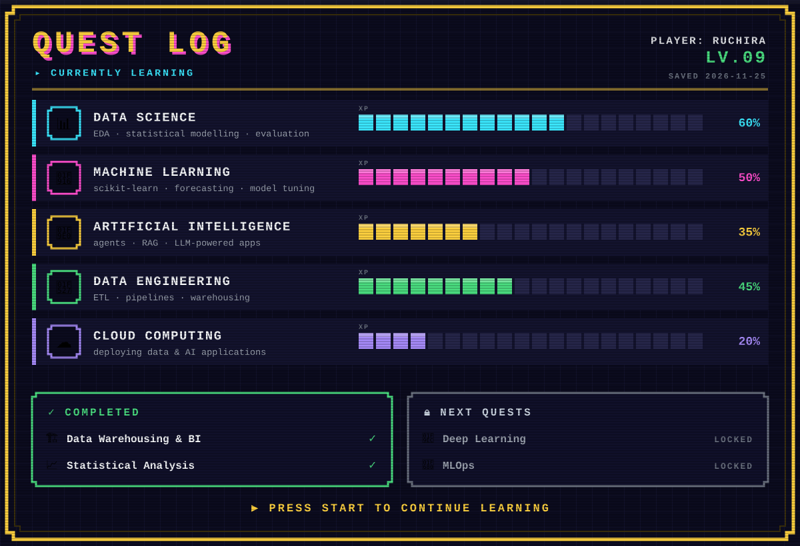</a>

🕹️ The quest log updates whenever I level up. It's drawn from <a href="./data/learning.json"><code>data/learning.json</code></a>.

  

> **Learn → Build → Break → Understand → Fix → Repeat.**

## 🎯 Where I'm heading

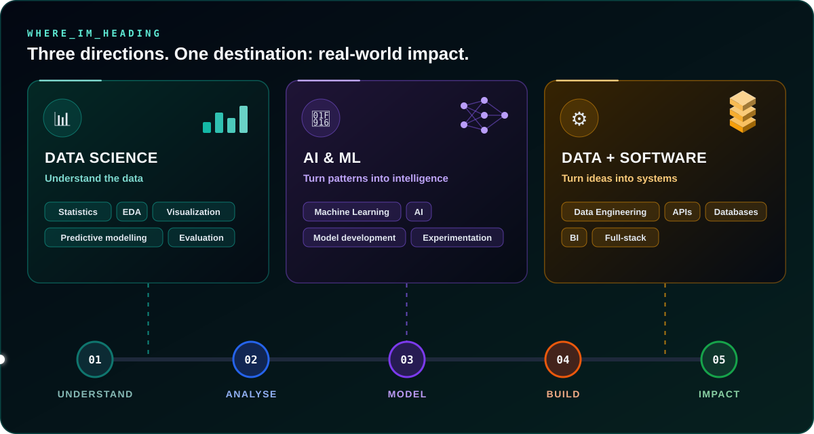

 

<b>🚀 The kind of work I want to grow into</b> (click to open)

 

> 💡 I want to work at the intersection of **data, intelligence and software** — taking a real-world problem, finding the evidence in the data, developing a useful model or solution, and turning the result into something people can actually use.

## 📈 Contributions in 3D

<picture>
  <source media="(prefers-color-scheme: dark)" srcset="./profile-3d-contrib/profile-night-rainbow.svg">
  <source media="(prefers-color-scheme: light)" srcset="./profile-3d-contrib/profile-season-animate.svg">
  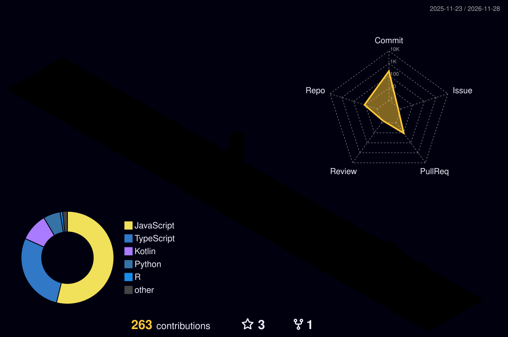
</picture>

 

 

<picture>
  <source media="(prefers-color-scheme: dark)" srcset="./profile-snake/snake-dark.svg">
  <source media="(prefers-color-scheme: light)" srcset="./profile-snake/snake-light.svg">
  
</picture>

 

## 🧩 Open a section

👇 Click each one to open it.

<b>📊 What I bring to a project</b>

 

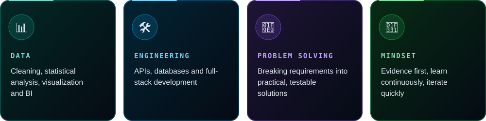

<b>🔬 My preferred problem-solving flow</b>

 

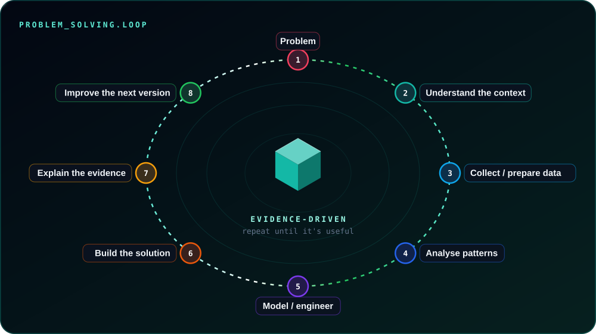

<b>🎯 Long-term direction</b>

 


## 🎸 Outside the code


## 🧭 My working mindset


## 📬 Contact me

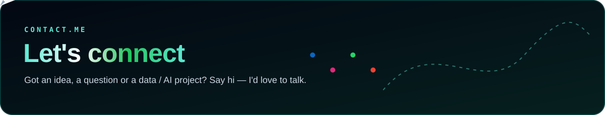

  

💬 Tap WhatsApp to open a chat with me directly · +94 71 627 6971

---

## 🤝 Thanks for visiting!

  

  

